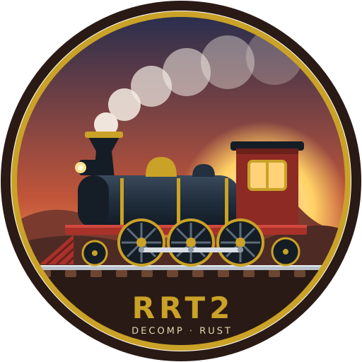

<div align="center">



# rrt2-decomp

**Reverse Engineering und eine moderne Rust-Neuimplementierung von _Railroad Tycoon II_**

[](https://www.rust-lang.org/)
[](#-fortschritt)
[](docs/PLAN.md)
[](#-bauen)
[](LICENSE)

_Der Klassiker von 1998, den Sie kennen, aus derselben isometrischen Perspektive,<br>jetzt nativ in 1080p, 4K und Ultrawide._

[English](README.md) · [Português](README.pt-BR.md) · [Español](README.es.md) · **Deutsch** · [中文](README.zh-CN.md) · [Русский](README.ru.md)

</div>

---

## 🚂 Über das Projekt

**rrt2-decomp** analysiert die ursprüngliche ausführbare Datei von _Railroad Tycoon II Platinum_ (PopTop Software, 1998–2001), um jede Spielregel zu verstehen, und schreibt das Spiel anschließend von Grund auf in Rust neu. Spielablauf und die isometrische 2D-Ansicht („Fake-3D“) bleiben erhalten, alles andere wird modernisiert:

- 🖥️ **Beliebige Auflösung**: 1080p, 1440p, 4K und Ultrawide, mit skalierbarer Oberfläche und HiDPI-Unterstützung. Oberfläche, Text und Gelände werden in jeder Auflösung nativ gerendert, und die Original-Sprites durchlaufen eine hochwertige Hochskalierung (xBRZ-Klasse oder Offline-KI-Modelle), die beim ersten Start zwischengespeichert wird.
- 🔍 **Stufenloser Zoom**, flüssiges Scrollen und Kameradrehung.
- 🧮 **Originalgetreue, deterministische Simulation**: Wirtschaft, Fracht, Städte, Industrien, Börse und KI, validiert gegen das Originalspiel.
- 🛠️ **Komfort**: Gleisbau per Ziehen mit Kostenvorschau, Rückgängig, Einblendungen für Nachfrage und Gewinn, Fuhrparkverwaltung, Autospeichern und frei belegbare Tasten.
- 🌎 **Mods und Lokalisierung**: Spieldaten in menschenlesbaren Dateien sowie Übersetzungen, darunter Deutsch.

> [!IMPORTANT]
> Dieses Projekt enthält **keine Assets aus dem Originalspiel**. Zum Spielen benötigen Sie eine rechtmäßig erworbene Kopie von _Railroad Tycoon II_ (zum Beispiel die Platinum Edition von [GOG](https://www.gog.com/game/railroad_tycoon_2_platinum)). Der Klon liest die Daten aus Ihrer Installation, nach demselben Modell wie [OpenRCT2](https://github.com/OpenRCT2/OpenRCT2) und [OpenTTD](https://github.com/OpenTTD/OpenTTD).

## 📊 Fortschritt

| Bereich | Status | Details |
|---|:---:|---|
| Plan und Architektur | ✅ | [`docs/PLAN.md`](docs/PLAN.md) |
| **PK2**-Archive | ✅ | Aufbau, Dateinamen-Hash und Archivvorrang · [spec](docs/formats/pk2.md) |
| **LNG**-Stringtabellen | ✅ | 2807 Strings und benannte Tabellen · [spec](docs/formats/lng.md) |
| Dateinamen in PK2 | 🟡 | 328 Namen aus der EXE wiederhergestellt, von 2898 Hashes |
| Sprites (LAD) und Paletten | ✅ | Sprites werden mit korrekten Farben dekodiert, 1990/1990 Bänke · [spec](docs/formats/lad.md) |
| UI-Layouts (`.win`) und Bitmap-Schriften | ✅ | Alle 46 Fensterlayouts werden geparst; die 10 Spielschriften werden mit Metriken dekodiert · [ui](docs/formats/ui.md) · [fonts](docs/formats/font.md) |
| Audio (`.raw`-Musik) | ✅ | Musik mit den Original-Kategorie- und Überblendregeln sowie alle 123 Soundeffekte (Mono, 16 Bit, 11025 Hz PCM) aus den Spieldaten · [spec](docs/formats/sound.md) |
| Karten und Spielstände (`.MAP` `.MP2` `.GAM`) | 🟡 | Beide Formatversionen (0x233C, 0x2348): alle 128 mitgelieferten Dateien und vom Original geschriebene Spielstände werden bis zum letzten Byte geparst; Gelände, Datum, Seed, Orte, Gesellschaften und Regeln dekodiert; Bahnhöfe und Züge teilweise · [spec](docs/formats/map-gam.md) |
| Simulationsspezifikationen (Züge, Fracht, Wirtschaft…) | 🟡 | Zeit/Kalender/Hauptschleife, Zufallsgeneratoren, Frachtwirtschaft, Zugbewegung/Pannen/Kosten, Gleis- und Bahnhofsbau samt Einzugsgebiet, Finanzen (Aktienkurs, Zinsen, Dividenden), Wachstum von Städten und Industrien, KI der Konkurrenten, Tick-Reihenfolge der Welt und die Szenario-Regelsprache, größtenteils bitgenau gegen das Original verifiziert · [time](docs/spec/time.md) · [rng](docs/spec/rng.md) · [cargo](docs/spec/cargo.md) · [trains](docs/spec/trains.md) · [track](docs/spec/terrain-track.md) · [finance](docs/spec/finance.md) · [growth](docs/spec/world-growth.md) · [AI](docs/spec/ai.md) · [world tick](docs/spec/world-tick.md) · [scenarios](docs/spec/scenarios.md) |
| Differenzielle Testumgebung (Unicorn) | ✅ | Führt Originalfunktionen in einem Emulator für bitgenaue Vergleiche aus · [docs](docs/oracle.md) |
| Render-Engine (wgpu) | 🟡 | Originalkarten mit den exakten Geländetexturen, Flüssen, Straßen, Stränden, Gleisen, Bäumen, Städten, Industrien und Bahnhöfen, dazu **fahrende Züge und Rauch** mit flüssiger Interpolation; hochskalierte Sprites für hohe Auflösungen; ~70 fps in 4K · `cargo run --release -p rt2-viewer -- <karte>` |
| Spielbare Simulation | 🟡 | Weltschleife `rt2-sim` mit Zügen, Bahnhöfen, Wirtschaft, Finanzen, Stadtwachstum, Szenarioregeln und der KI-Konkurrenz: Im Klon fortgeschriebene Original-Spielstände sind in **allen 131** Fällen, von 1 Tag bis zu 2 Spieljahren, einschließlich seltener Ereignisse (Unfälle, Diebstahl, Liquidationen, KI-Aktienhandel) Feld für Feld **identisch mit dem Original** (Tutorial, Example mit Zügen, vier .MP2-Karten sowie beim Laden konvertierte alte Spielstände und Karten); einschließlich neuer Spiele aller 18 Szenarien der Originalkampagne; und aller 18 Second-Century-Szenarien · [Treue-Tabelle](docs/fidelity-status.md) |
| Spieloberfläche | 🟡 | App `rrt2`: Hauptmenü mit Originalgrafik, Szenario- und Spielstandlisten, HUD im Spiel mit Datum und Geschwindigkeitsregelung, gestochen scharfer Vektortext mit OFL-Schriften, die den Originalen nachempfunden sind, UI-Skalierung 100–300 % · [docs](docs/ui.md) |
| Karten- und Szenario-Editor | 🟡 | Gelände, Bäume, Gebiete, Gebäude, Orte, Flüsse und Straßen; Kartenoptionen, Ziele und ein Regeleditor mit Live-Prüfung; Speichern erhält alle mitgelieferten Karten unverändert. PCX-Import und einige Optionsseiten fehlen noch |

<sub>✅ fertig · 🟡 teilweise · 🔍 in Analyse · ⏳ geplant</sub>

**Originaltreue:** Klon und Original schreiben denselben Spielstand fort, und die Ergebnisse werden Feld für Feld verglichen. Aktuelle Wertung: [`docs/fidelity-status.md`](docs/fidelity-status.md).

**Reverse Engineering:** 2945 Funktionen in der ausführbaren Datei (1837 ohne Linker-Thunks) · 853 Symbole in [`re/symbols.toml`](re/symbols.toml) · 1318 klassifiziert (44 %), 1627 noch nicht klassifiziert · 477 Funktionen spezifiziert (davon 429 Simulation), 301 bitgenau gegen das Original verifiziert ([`re/coverage.toml`](re/coverage.toml)). Ein Prozentwert für die Simulationsabdeckung wird veröffentlicht, sobald die Klassifizierung abgeschlossen ist.

## 🧭 Fahrplan

```
Phase 0  Grundlagen ........................ ✅
Phase 1  Dateiformate und Extraktion ....... 🚧  ← hier sind wir
Phase 2  Dekompilierung je Subsystem ....... ⏳
Phase 3  Render-Engine ..................... ⏳  (parallel zu Phase 2)
Phase 4  Spielbarer Vertical Slice ......... ⏳
Phase 5  Vollständiges Spiel ............... ⏳
Phase 6  Modernisierung und Feinschliff .... ⏳
```

Details zu den Phasen, Risiken und Fertigkeitskriterien stehen in [`docs/PLAN.md`](docs/PLAN.md) (auf Portugiesisch).

## 🔧 Bauen

Sie benötigen stabiles Rust (festgelegt durch [`rust-toolchain.toml`](rust-toolchain.toml)). Unter Linux brauchen Sie außerdem `clang` und `mold`, die [`.cargo/config.toml`](.cargo/config.toml) als Linker verwendet.

```bash
git clone https://github.com/pedryvo/rrt2-decomp.git
cd rrt2-decomp
cargo build --release
```

Tests, die die Originalspieldaten lesen, laufen, wenn `RT2_DIR` auf Ihre Installation zeigt:

```bash
RT2_DIR=~/Games/railroad-tycoon-2 cargo nextest run
```

## 📦 Installation

1. Lade das Archiv für dein System von der [Releases-Seite](https://github.com/pedryvo/rrt2-decomp/releases) herunter (Linux x86_64 `.tar.gz`, `.AppImage` oder `.flatpak`; Windows x86_64 Installer `-setup.exe` oder portables `.zip`; macOS Apple Silicon oder Intel `.dmg` mit `RRT2.app`, oder `.tar.gz`). Der Windows-Installer braucht keine Administratorrechte, legt eine Startmenü-Verknüpfung und ein Deinstallationsprogramm an und kann sich den Spielordner merken; die Pakete sind nicht codesigniert, daher warnen Windows SmartScreen und der macOS-Gatekeeper beim ersten Start (unter macOS: Rechtsklick → Öffnen, oder `xattr -dr com.apple.quarantine /Applications/RRT2.app`). Das AppImage läuft direkt; das Flatpak hat keinen Zugriff auf deine Dateien, bis du Lesezugriff auf den Spielordner gewährst, siehe [docs/packaging.md](docs/packaging.md). Jeder Push auf `main` erzeugt außerdem Entwicklungs-Builds, die als Artefakte der "Release"-Workflow-Läufe im Actions-Tab liegen.
2. Entpacke es irgendwo (oder starte den Windows-Installer, oder ziehe `RRT2.app` aus dem `.dmg` in den Programme-Ordner). Das Paket enthält nur `rrt2` (Schriften und Übersetzungen sind eingebaut), die Dokumentation und die Schriftlizenzen. **Das Originalspiel ist nicht enthalten**: Du brauchst deine eigene Kopie von Railroad Tycoon II (GOG, Steam oder CD-Installation).
3. Sage dem Spiel beim ersten Start, wo das Original installiert ist. Der Pfad wird in `config.toml` gespeichert:

```bash
./rrt2 set-path ~/Games/railroad-tycoon-2     # Windows: rrt2.exe set-path "C:\Games\Railroad Tycoon II"
./rrt2
```

`rrt2 --version` zeigt Version und Git-Commit. Statt `set-path` kannst du auch `--game-dir <Ordner>` übergeben oder `RT2_DIR` setzen.

| | Linux | Windows | macOS |
|---|---|---|---|
| Einstellungen und Tasten (`config.toml`) | `~/.config/rrt2` | `%APPDATA%\rrt2` | `~/Library/Application Support/rrt2` |
| Spielstände | `~/.local/share/rrt2/saves` | `%APPDATA%\rrt2\saves` | `~/Library/Application Support/rrt2/saves` |

`RRT2_CONFIG` und `RRT2_SAVES` überschreiben diese beiden Orte. Die macOS- und Windows-Builds stammen aus der CI und wurden vom Autor noch nicht getestet.

## 🎮 Das Spiel starten (frühe Vorschau)

```bash
cargo run --release -p rt2-game -- set-path ~/Games/railroad-tycoon-2   # einmalig
cargo run --release -p rt2-game
```

Sie können jedes Szenario und jede Kampagne von Grund auf starten, Ihre Gesellschaft gründen, Gleise verlegen, Bahnhöfe und Nebengebäude bauen, Züge kaufen und ihre Routen festlegen, Industrien kaufen und Zeitungen, Finanzen und Börse verfolgen, während die Simulation läuft. Anleihen, Aktienhandel und einige Bildschirme fehlen noch (siehe die Übersicht in `docs/reference/screens.md`). Einstellungen und Tastenbelegung liegen in `~/.config/rrt2/config.toml`; Spielstände landen in `~/.local/share/rrt2/saves`.

## 🧰 Werkzeuge

Vorerst besteht das Projekt aus einer Sammlung von Analysewerkzeugen. Das Spiel kommt später.

```bash
# ein PK2-Archiv auflisten und die bekannten Einträge benennen
cargo run --bin rt2-extract -- ~/Games/railroad-tycoon-2/data/RT2.PK2 -n re/names/exe_filenames.txt

# alles in einen Ordner extrahieren
cargo run --bin rt2-extract -- ~/Games/railroad-tycoon-2/data/RT2.PK2 -n re/names/exe_filenames.txt -o assets-extracted/rt2

# den Hash eines Dateinamens berechnen
python3 re/scripts/pk2_hash.py setup.imb
```

## 🗂️ Aufbau

```
crates/
  rt2-formats/   reine Parser für die Dateiformate des Spiels (PK2, LNG, …)
  rt2-sim/       deterministischer Simulationskern (keine E/A, kein Rendering)
  rt2-render/    wgpu-Geländerenderer (Mesh, isometrische Kamera; keine Spiellogik)
  rt2-viewer/    `rt2-viewer <map>`: Fenster oder `--screenshot` als PNG
  rt2-oracle/    Umgebung für Differenzialtests (Original-EXE in Unicorn)
  rt2-tools/     CLIs zur Analyse und Extraktion
docs/
  PLAN.md        Entwicklungsplan
  formats/       eine Spezifikation je Dateiformat
  spec/          eine Spezifikation je Spielsubsystem
  reference/     aus Handbuch und Strategieführer extrahierte Regeln
re/
  symbols.toml   in der ausführbaren Datei identifizierte Funktionen und Globals (maßgebliche Quelle)
  names/         wiederhergestellte Dateinamen
  scripts/       Hilfsskripte für das Reverse Engineering
```

## 🔬 Methodik

1. **Ankerpunkte**: Strings, Importe und Datentabellen in der ausführbaren Datei zeigen, wo jedes Subsystem liegt.
2. **Vollständige Klassifizierung, gezielte Dekompilierung**: Jede Funktion wird klassifiziert (Bibliothek, Plattform, Rendering, UI oder Simulation), und wir arbeiten uns von den Ankerpunkten aus Subsystem für Subsystem nach außen vor. Bibliothekscode (CRT, Miles, Smacker, DirectX) wird früh beiseitegelegt, und jede Simulationsfunktion erhält eine Spezifikation.
3. **Spezifikation vor Code**: Die Regeln werden in [`docs/spec/`](docs/spec/) mit Pseudocode, Konstanten und der Quelladresse jeder Regel festgehalten. Der Rust-Code entsteht aus den Spezifikationen, nicht aus dem Assembler.
4. **Die ausführbare Datei ist die Referenz, nicht das Handbuch**: Jede Simulationsfunktion wird spezifiziert, die Abdeckung wird öffentlich verfolgt. Formeln werden als gleichwertig nachgewiesen, indem die Originalfunktionen in einem x86-Emulator gegen unseren Rust-Code laufen, und das Verhalten des gesamten Spiels wird geprüft, indem derselbe Spielstand im Original (unter Wine) und im Klon fortgeschrieben und das Ergebnis verglichen wird.

Die Analyse nutzt [Ghidra](https://ghidra-sre.org/) über den MCP-Server **REA**. Die Arbeit ist auf spezialisierte KI-Agenten verteilt ([`.claude/agents/`](.claude/agents/)), die jeweils das für ihre Aufgabe am besten geeignete Modell verwenden.

Die Projektdokumentation unter `docs/` ist auf Portugiesisch verfasst.

## 🙏 Inspiration

- [OpenRCT2](https://github.com/OpenRCT2/OpenRCT2), [OpenTTD](https://github.com/OpenTTD/OpenTTD) and [OpenMW](https://github.com/OpenMW/openmw): Neuimplementierungen, die mit den Originaldaten laufen
- [n64decomp/sm64](https://github.com/n64decomp/sm64) and [zeldaret/oot](https://github.com/zeldaret/oot): Vorbilder für die Dokumentation von Reverse-Engineering-Arbeit

## ⚖️ Rechtliches

_Railroad Tycoon_ ist eine Marke der jeweiligen Rechteinhaber. Dies ist ein nicht kommerzielles Fanprojekt ohne Verbindung zu PopTop Software, Take-Two Interactive oder anderen Rechteinhabern. Hier werden weder Originalcode noch Original-Assets verbreitet. Das Repository enthält nur neuen Code, durch Reverse Engineering zur Interoperabilität erstellte Dokumentation und die Dateinamen, die zum Lesen der Daten einer rechtmäßigen Kopie nötig sind.

Der Quellcode von rrt2-decomp steht unter der [GNU General Public License v3.0 oder später](LICENSE). Die mitgelieferten Schriften stehen unter der SIL Open Font License (siehe `assets/fonts/`).
